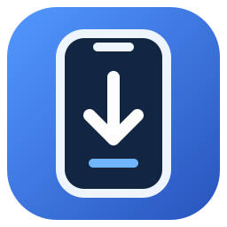

<p align="center">
  
</p>

# IPA Desktop

**Поиск, скачивание и установка приложений для iPhone — в одном окне Windows.**

IPA Desktop — независимый графический интерфейс на C# и WPF. Программа получает ipatool напрямую из [Sorvigolova/ipatool](https://github.com/Sorvigolova/ipatool), использует каталог из [IPA Downloader](https://github.com/kda2495/IPA_Downloader) и наш Windows-комплект libimobiledevice/ideviceinstaller, работает с Apple Account через ipatool и устанавливает IPA на подключённый iPhone через ideviceinstaller.

**[Скачать актуальную сборку →](https://github.com/Lis1us/IPA-Desktop/releases/latest)** · [История изменений](https://github.com/Lis1us/IPA-Desktop/releases) · [Сообщить об ошибке](https://github.com/Lis1us/IPA-Desktop/issues)

> Проект находится в развитии. Доступность скачивания и установки зависит от Apple Account, приложения, версии iOS и ответа используемых утилит.

## Содержание

[Возможности](#возможности) · [Требования](#требования) · [Быстрый старт](#быстрый-старт) · [Использование](#использование) · [Обновления](#обновления) · [Данные](#где-хранятся-данные) · [Помощь](#если-что-то-не-работает) · [Разработка](#разработка) · [Кредиты](#авторы-и-кредиты) · [Лицензия](#лицензия)

## Возможности

| Функция | Что доступно |
|---|---|
| Поиск | По названию или App Store ID; объединение каталога, пользовательского списка и App Store |
| Версии | Последняя или конкретная версия, сведения о номере и дате выпуска |
| Скачивание | Общий список выбранных приложений из разных поисковых запросов |
| Локальные IPA | Импорт, просмотр размера и Apple Account из метаданных, удаление в корзину |
| Установка | Проверка компонентов Apple, поиск iPhone по USB, его имя и очередь IPA |
| Обновления | Обновление IPA Desktop, обновление движка и откат движка |
| Журнал | Последние сообщения, автопрокрутка и диагностика длительных операций |

## Требования

- **Windows 10 или Windows 11, x64.**
- **.NET Framework 4.6 или новее.**
- Доступ к GitHub и сервисам Apple.
- Apple Account для работы с App Store.
- Для установки IPA: **Apple Mobile Device Support**, USB-подключение и подтверждённое доверие iPhone к компьютеру.

Приложение запускается без установки. Распакуйте его в папку, доступную для записи, например в своём профиле Windows. Запуск оболочки от администратора не требуется.

## Быстрый старт

1. Откройте [последний релиз](https://github.com/Lis1us/IPA-Desktop/releases/latest).
2. В разделе **Assets** скачайте архив `IPA-Desktop-<версия>-Windows.zip`.
3. **Полностью распакуйте архив** в отдельную папку.
4. Запустите `IPA-Desktop.exe`. Остальные файлы оставьте рядом: не переносите один EXE отдельно.
5. При первом запуске дождитесь установки движка IPA Downloader.
6. Нажмите **«Войти в Apple Account»** и завершите вход в открывшемся консольном окне.
7. Найдите приложение, добавьте его в выбранное и нажмите **«Скачать (N)»**.

Если автоматическое получение движка отключено или не удалось, откройте **«Обновления» → «Проверить обновления»** в блоке движка.

## Использование

### 1. Вход в Apple Account

Нажмите **«Войти в Apple Account»**. Почта, пароль и код двухфакторной аутентификации вводятся в штатном консольном окне ipatool.

После подтверждения сессии в интерфейсе появится адрес аккаунта, а кнопка входа станет неактивной. **«Проверить аккаунт»** проверяет сохранённую сессию, **«Выйти»** завершает её.

Сессия используется совместно с исходным IPA Downloader. Переключение нескольких аккаунтов и дополнительная фраза защиты keychain в интерфейсе не поддерживаются.

### 2. Поиск и выбор приложений

На вкладке **«Поиск и загрузка»** введите название приложения или числовой App Store ID и нажмите **«Найти»** либо Enter.

**Клик ЛКМ по строке** добавляет приложение в список выбранных снизу. Можно выполнить другой поиск: уже выбранные приложения останутся в списке.

- **Ctrl / Shift** — выделить несколько результатов; **«В выбранное»** — добавить выделенную группу.
- **Крестик ×** — убрать одно приложение из выбранного.
- **«Очистить»** — сбросить весь выбранный список.
- Повторный клик не создаёт дубликат.
- Очистка строки поиска убирает результаты, сохраняя выбранные приложения.

Список выбранного действует до закрытия программы.

### 3. Выбор версии и скачивание

По умолчанию скачивается **последняя версия**. Для конкретной версии:

1. Выделите одно приложение в результатах поиска.
2. Нажмите **«Список версий»**.
3. Выберите версию в выпадающем списке.
4. Нажмите **«В выбранное»**, чтобы сохранить эту версию для приложения.

В списке версий отображаются идентификаторы Apple. Кнопка **«Сведения»** показывает доступный номер версии и дату выпуска. У каждого выбранного приложения может быть своя версия.

**«Скачать (N)»** загружает весь выбранный список по очереди. Успешные загрузки убираются из списка; ошибочные и незавершённые остаются для повтора.

**«Папка IPA»** открывает каталог скачанных файлов. Загрузка может потребовать получения бесплатной лицензии через Apple; ограничения аккаунта и доступность приложения сохраняются.

### 4. Файлы и установка на iPhone

Откройте вкладку **«Файлы и устройство»**. Статус компонентов Apple показан над таблицей IPA; **«Проверить драйвер»** повторяет проверку, **«Помощь Apple»** открывает официальную инструкцию по установке ПО или запуску службы.

Проверяются служба Apple Mobile Device и регистрация компонентов в Windows. Запущенная служба обнаруживается и без отдельной записи Apple Mobile Device Support в списке программ. Эта проверка не подтверждает исправность USB-драйвера конкретного iPhone; поиск устройства остаётся доступен.

1. Подключите iPhone по USB, разблокируйте его и подтвердите **«Доверять этому компьютеру»**.
2. Нажмите **«Найти iPhone»**. До обнаружения устройства кнопка зелёная.
3. Выберите iPhone в списке устройств. Отображается имя из настроек телефона; если имя недоступно — короткий идентификатор.
4. Кликайте ЛКМ по IPA-файлам, чтобы собрать список установки снизу.
5. Нажмите **«Установить (N)»** и подтвердите установку.

Успешно установленные IPA убираются из списка установки. Остальные остаются для повторной попытки.

| Действие | Результат |
|---|---|
| «Добавить IPA…» | Копирует выбранные IPA в папку приложения |
| «Обновить файлы» | Перечитывает локальные IPA, сохраняя выбор существующих файлов |
| «В выбранное» | Добавляет выделенную группу файлов к установке |
| Крестик × / «Очистить» | Убирает элементы только из списка установки |
| «Удалить выбранные» | Перемещает выделенные в таблице IPA в корзину Windows |

Удаление IPA с диска не удаляет приложение с iPhone. Для освобождения места после удаления очистите корзину Windows.

**Колонка Apple Account** читается из метаданных внутри IPA, в том числе импортированных. Если аккаунт не указан, отображается **«Не указан»**. Метаданные не подтверждают права установки со стороны Apple; текущий аккаунт программы не подставляется вместо отсутствующих данных.

### 5. Журнал и отмена

Во вкладке **«Журнал»** отображаются последние сообщения. При переходе в неё и поступлении новых строк выполняется прокрутка вниз.

Во время длительной загрузки или установки журнал сообщает время работы процесса и время без нового вывода. Отсутствие сообщений само по себе не означает зависание.

**«Отмена»** останавливает текущую операцию. Уже завершённые загрузки и установки не откатываются.

## Обновления

Во вкладке **«Обновления»** находятся три независимых блока:

| Блок | Как обновить |
|---|---|
| **IPA Desktop** | «Проверить версию» → «Обновить до …» → подтвердить перезапуск |
| **Движок ipatool** | «Проверить обновления» → подтвердить установку нового движка |
| **Инструменты для iPhone** | «Проверить инструменты» → подтвердить обновление комплекта |

Проверки при запуске можно включать и отключать отдельно.

Движок загружается из официальных Releases `Sorvigolova/ipatool` (архив `windows_amd64_ipatool-cpp.zip`). Каталог IPA Downloader обновляется отдельно при поиске, с сохранённой копией на случай недоступности сети.

Наш комплект для iPhone собирается из зафиксированных исходных ревизий libimobiledevice и ideviceinstaller. Он опубликован в этом репозитории отдельными релизами `device-tools-v…`, с DLL, лицензиями и архивом исходников. Сборка описана в [Tools/DeviceTools](Tools/DeviceTools/README.md). Из IPA Downloader берётся только каталог; его архивы и скрипты больше не скачиваются.

Каждый день GitHub Actions проверяет новые стабильные релизы исходных проектов. При обновлении автоматически собирается и тестируется новый комплект, затем публикуется релиз с чейнджлогом. Ошибка сборки или проверки сохраняет прежний комплект. Предварительные версии и отдельные коммиты не распространяются автоматически.

При переходе старые инструменты остаются доступными для отката. Новая сборка проверяется при запуске (можно отключить) или кнопкой «Проверить инструменты». Перед переключением проверяются SHA-256, состав комплекта и запуск трёх утилит. «Откатить комплект» возвращает предыдущие инструменты и отключает только их автообновление. Обновление и откат ipatool сохраняют этот комплект. Скачанные IPA и сессия аккаунта сохраняются. Apple Mobile Device Support/служба Apple по-прежнему нужны для USB-подключения.

При обновлении IPA Desktop архив проверяется по размеру и SHA-256, сохраняется резервная копия заменяемых файлов, затем программа перезапускается. При ошибке копирования выполняется откат. Скачанные IPA и настройки сохраняются.

**«Откатить движок»** возвращает предыдущую версию ipatool (при первом переходе — старый комплект IPA Downloader) и отключает его автообновление. Старые папки движка автоматически не удаляются.

Если установленная версия не поддерживает обновление из интерфейса, скачайте актуальный ZIP вручную и распакуйте в отдельную папку.

## Где хранятся данные

| Данные | Путь |
|---|---|
| Скачанные и импортированные IPA | `%LOCALAPPDATA%\IPA-Desktop\Apps` |
| Установленные версии движка | `%LOCALAPPDATA%\IPA-Desktop\Versions` |
| Настройки интерфейса | `%LOCALAPPDATA%\IPA-Desktop\state.json` |
| Пользовательский каталог | `%LOCALAPPDATA%\IPA-Desktop\Files\AppsListCustom.txt` |
| Временные файлы обновления программы | `%LOCALAPPDATA%\IPA-Desktop\GuiUpdates` |
| Сессия ipatool | `%USERPROFILE%\.ipatool` |

В пользовательском каталоге указывайте по одной записи на строку:

```text
Название приложения: App Store ID
```

Пароль вводится в консоль ipatool и не передаётся оболочкой аргументом процесса. Хранением сессии занимается ipatool.

## Если что-то не работает

| Ситуация | Что проверить |
|---|---|
| iPhone не найден | USB-кабель, разблокировку, доверие компьютеру и Apple Mobile Device Support; затем повторить поиск |
| Имя iPhone не отображается | Доверие и разблокировку; причина чтения имени отображается в журнале |
| Ошибка скачивания | Сохранённый вход, доступность приложения для аккаунта и сообщения ipatool в журнале |
| Ошибка установки | Ответ установщика и совместимость IPA с iOS; предварительная проверка минимальной iOS пока не выполняется |
| Долгое ожидание загрузки | Последние строки журнала; при необходимости отменить операцию и повторить |
| Ошибка обновления программы | Доступ на запись в папку приложения и возможность скачивания с GitHub |

Если ошибка повторяется, создайте [Issue](https://github.com/Lis1us/IPA-Desktop/issues). Укажите версии IPA Desktop, движка и Windows, шаги воспроизведения и последние сообщения журнала. Перед публикацией уберите адрес Apple Account, идентификатор устройства и другие личные данные.

## Разработка

Исходники организованы по объектно-ориентированным слоям:

- **Domain** — модели и правила выбора.
- **Infrastructure** — процессы, настройки, сеть и метаданные.
- **Services** — каталог, загрузки, устройства и обновления.
- **Presentation** — окно и контроллеры вкладок.

| Папка | Содержимое |
|---|---|
| [Assets](Assets) | Иконка Windows и исходник SVG |
| [Tests](Tests) | Проверки компонентов, интерфейса, обновления и структуры пакета |
| [Scripts](Scripts) | Синхронизация исходников, упаковка и установка обновлений |
| [Docs](Docs) | Описание архитектуры |
| [Source](Source) | Классы для разработки |
| [Generated](Generated) | Автоматические копии исходников для переносимой сборки |

 Подробности, сборка и проверки описаны в [ARCHITECTURE.md](Docs/ARCHITECTURE.md).

После изменения классов синхронизируйте переносимые файлы сборки и запустите компилятор:

```powershell
powershell -NoProfile -ExecutionPolicy Bypass -File Scripts/Sync-Sources.ps1
.\Build.cmd
```

Используется штатный компилятор .NET Framework; Visual Studio и NuGet для этой сборки не требуются. Файлы в `Generated` генерируются из `Source` и сохраняют совместимость с обновлением предыдущих версий.

GitHub Actions проверяет код на Windows, собирает ZIP и публикует его в Releases. Для каждой версии требуется чейнджлог в [changelogs](changelogs).

## Авторы и кредиты

| Проект / автор | Вклад |
|---|---|
| [Lis1us](https://github.com/Lis1us) | Проект IPA Desktop и сопровождение |
| OpenAI Codex | Помощь в разработке, рефакторинге и проверках оболочки |
| [kda2495 / IPA Downloader](https://github.com/kda2495/IPA_Downloader) | Только каталог приложений |
| [Sorvigolova / ipatool](https://github.com/Sorvigolova/ipatool) | Прямой источник Windows-релизов ipatool; вход, поиск, версии и скачивание приложений |
| [libimobiledevice](https://github.com/libimobiledevice/libimobiledevice) | Поиск подключённых устройств и чтение информации о них |
| [ideviceinstaller](https://github.com/libimobiledevice/ideviceinstaller) | Установка IPA на устройства |

IPA Desktop — самостоятельная оболочка, не официальный интерфейс Apple или авторов перечисленных проектов. Новая логика PowerShell-скрипта IPA Downloader не переносится в интерфейс автоматически.

## Лицензия

Код IPA Desktop распространяется по [MIT License](LICENSE.txt).

Сторонние утилиты скачиваются отдельно из IPA Downloader и сохраняют лицензии своих авторов. Их бинарные файлы не включены в ZIP оболочки.

Компоненты комплекта для iPhone распространяются по собственным лицензиям LGPL/GPL и другим лицензиям зависимостей; их лицензии и исходники приложены к релизу комплекта. MIT относится к интерфейсу IPA Desktop.
